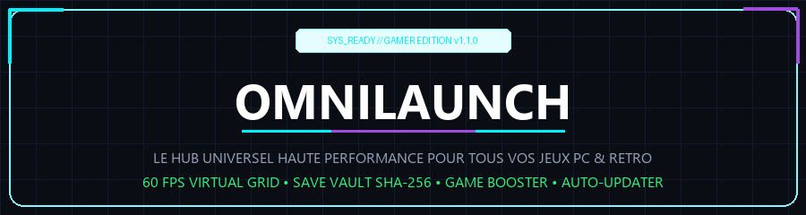

 

[-00f0ff?style=for-the-badge&logo=rocket)](https://github.com/baffert/OmniLaunch-Releases)

 

### ⚡ **Le Lanceur Universel de Jeux Vidéo pour PC & Émulateurs**
**Centralisez, optimisez et lancez tous vos jeux Steam, Epic, Xbox, EA, Ubisoft, GOG, Battle.net, Riot, Standalone et Rétro depuis une interface unique ultra-rapide.**

 

[📥 **Télécharger l'Installateur Automatique (v1.3.0)**](https://github.com/baffert/OmniLaunch-Releases/releases/download/v1.3.0/OmniLaunch_v1.3.0_Installateur.zip) &nbsp;&nbsp;•&nbsp;&nbsp; [⚡ **Télécharger la Version Portable (v1.3.0)**](https://github.com/baffert/OmniLaunch-Releases/releases/download/v1.3.0/OmniLaunch.zip)

 

---

## 🎮 Pourquoi OmniLaunch ?

* **🎯 Compteur de FPS & HUD Gamer In-Game (Nouveau)** : Télémétrie ultra-précise en temps réel alimentée par **Intel PresentMon (ETW)** & DWM. Mesure matérielle directe du framerate et du frametime (ms) 100% sécurisée contre les anti-triches (aucun hook ni injection DLL). Overlay transparent click-through sans aucune perte de focus ni gêne de visée.
* **🚀 Grille Virtualisée 60 FPS** : Architecture Modèle/Vue (`QListView` + `QStyledItemDelegate`) capable d'afficher instantanément des collections de **plus de 1 000 jeux** en moins de 50 millisecondes, avec zéro saccade.
* **🌟 Hero Showcase Panoramique** : Artworks dynamiques haute définition avec fondu progressif cinéma sans coupure nette.
* **🎁 Bons Plans & Jeux Gratuits Rétro-actifs** : Détection quotidienne en temps réel des cadeaux Epic Games et Steam avec accès direct et bannières grand format.
* **📊 Insights Joueur & Statistiques Avancées** : Télémétrie de bibliothèque, plateforme dominante, classement dynamique Hall of Fame et historique de vos sessions de jeu.
* **🛡️ Save Vault SHA-256** : Sauvegardes locales automatiques compressées et dédupliquées pour ne plus jamais perdre une progression.
* **⚡ Game Booster Intégré** : Ajustement dynamique de la priorité CPU et du plan d'alimentation Windows pour maximiser les performances en jeu.
* **🕹️ Écosystème Rétro & Émulateurs** : Scan automatique de vos dossiers de ROMs et intégration de RetroArch, Dolphin, PCSX2, RPCS3, DuckStation, etc.
* **🔄 Auto-Updater GitHub Transparent** : Notification instantanée des nouvelles versions au lancement, téléchargement avec barre de progression et validation cryptographique SHA-256.

---

## 📦 Téléchargements & Versions

| Version | Type | Fichier | Taille | Hash SHA-256 |
| :--- | :--- | :--- | :--- | :--- |
| **v1.3.0 (Build 42)** | 📦 **Installateur 1-Clic** | [`OmniLaunch_v1.3.0_Installateur.zip`](https://github.com/baffert/OmniLaunch-Releases/releases/download/v1.3.0/OmniLaunch_v1.3.0_Installateur.zip) | ~55 Mo | `Voir version.json` |
| **v1.3.0 (Build 42)** | ⚡ **Archive Portable** | [`OmniLaunch.zip`](https://github.com/baffert/OmniLaunch-Releases/releases/download/v1.3.0/OmniLaunch.zip) | ~55 Mo | `07e703dd74e00e568813c7e4a246cd005146557ae727f6e0a4899f69e7994887` |

---

## 🚀 Guide d'Installation

### Option 1 : Avec l'Installateur (Recommandé)
1. Téléchargez [`OmniLaunch_v1.3.0_Installateur.zip`](https://github.com/baffert/OmniLaunch-Releases/releases/download/v1.3.0/OmniLaunch_v1.3.0_Installateur.zip).
2. Faites un clic droit > **Extraire tout**.
3. Lancez **`Installer_OmniLaunch.bat`**.
4. L'assistant déploie l'application, crée le raccourci sur votre Bureau et dans le Menu Démarrer avec l'icône officielle.

### Option 2 : Version Portable (Sans Installation)
1. Téléchargez [`OmniLaunch.zip`](https://github.com/baffert/OmniLaunch-Releases/releases/download/v1.3.0/OmniLaunch.zip).
2. Décompressez l'archive où vous voulez (sur votre PC ou sur une clé USB).
3. Double-cliquez sur **`OmniLaunch.exe`** ou **`Lancer_OmniLaunch.bat`** pour jouer immédiatement.

---

OmniLaunch Gamer Edition • Développé avec passion pour les joueurs PC

